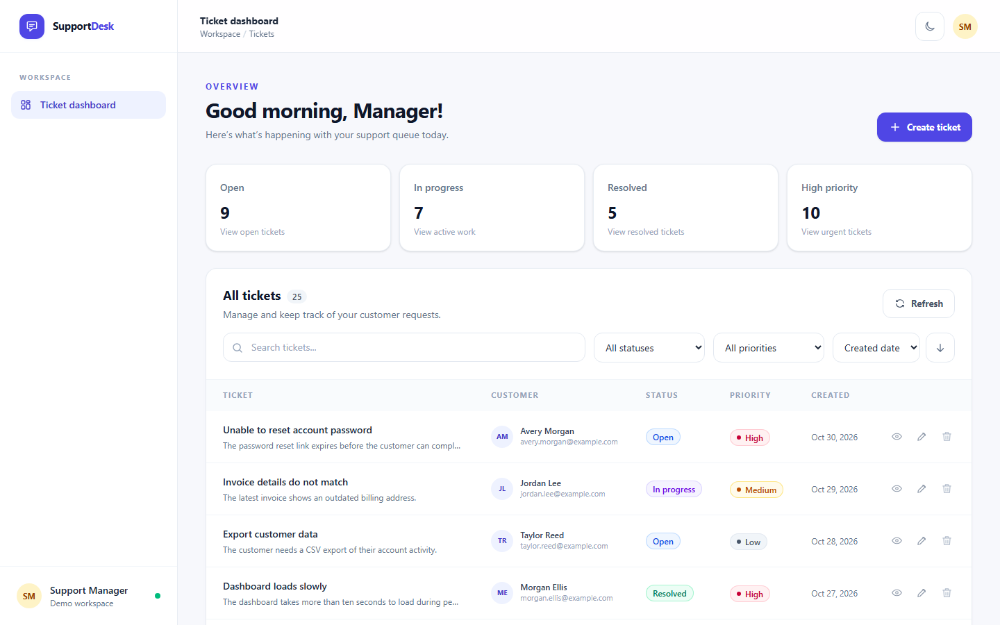
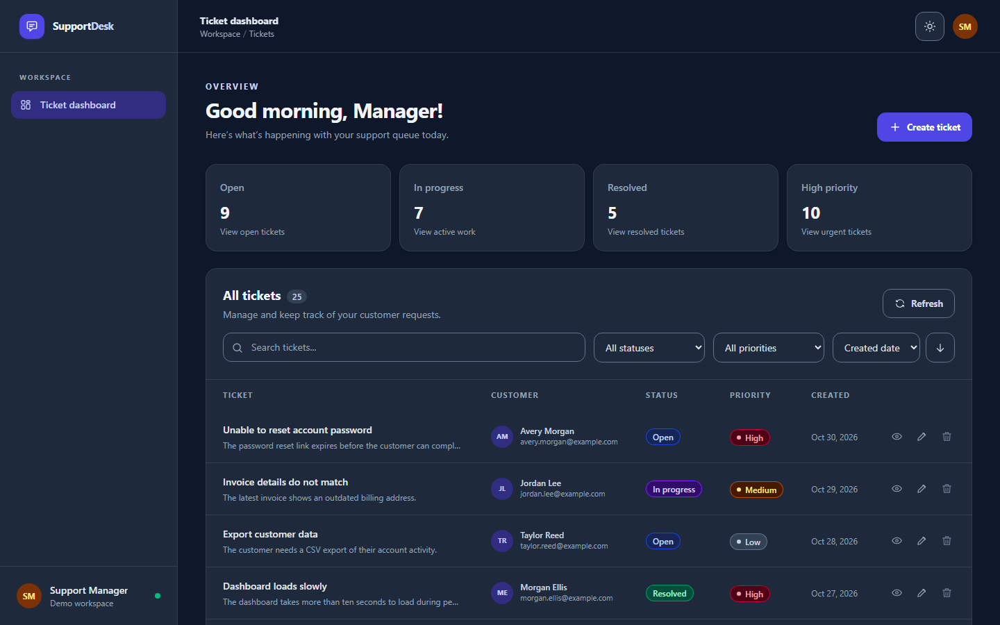
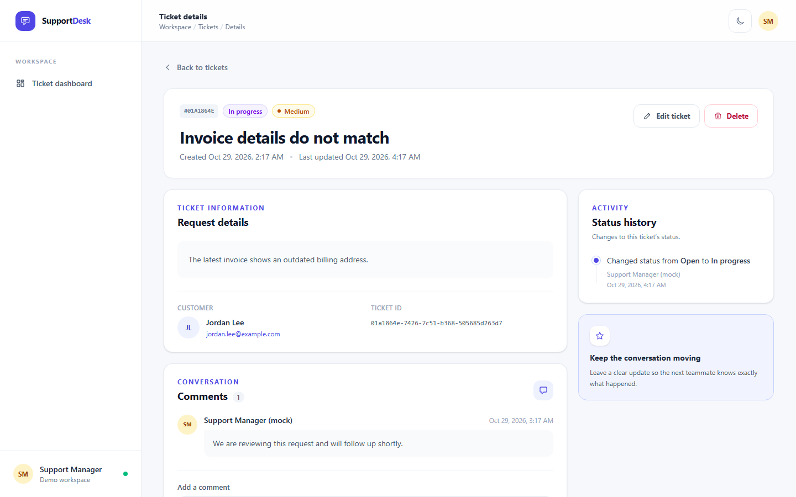
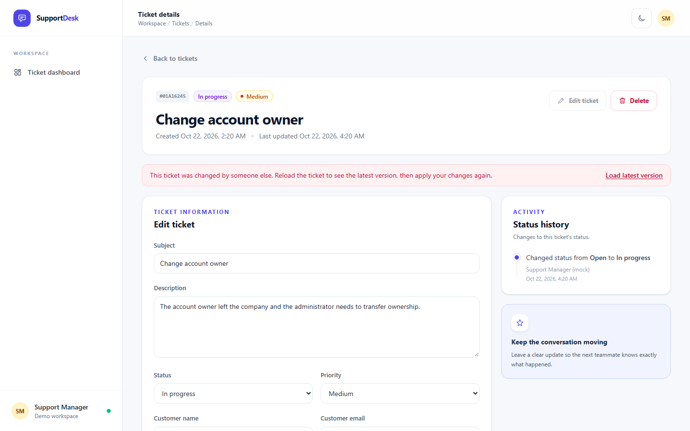
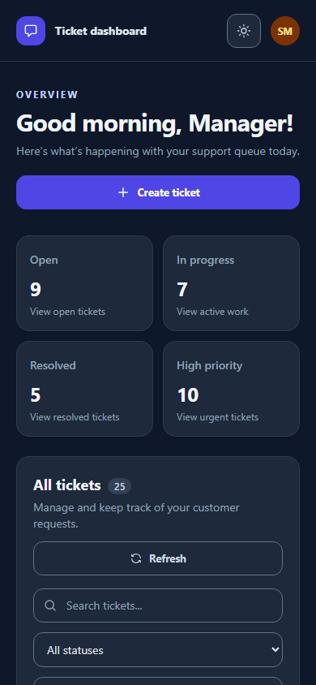

# Support Desk

A customer support dashboard for managing tickets, built with ASP.NET Core Web API and Vue 3.

Live Demo: [https://support-desk-frontend-rouge.vercel.app/](https://support-desk-frontend-rouge.vercel.app/)

## Screenshots

**Dashboard** — queue summary cards that double as filters, search, filters, sorting, and per-row actions.



**Dark mode** — the same screen with the dark theme.



**Ticket details** — ticket information, comments, and status history.



**Edit conflict** — a teammate saved this ticket while it was being edited; the edit is kept on screen instead of silently overwriting their change.



**Mobile** — tickets become cards and actions stay reachable on small screens.



## Features

- Browse, search, filter, and sort support tickets; the list criteria live in the URL, so they survive a reload and are restored when returning from a ticket.
- Create, edit, and delete tickets, with view, edit, and delete actions directly in the list.
- View ticket details, customer information, comments, and status history.
- Add comments and track status changes.
- Switch between light and dark themes; the selected theme is saved in the browser.
- Persistent SQLite storage with sample tickets for local development.

## Stack and architecture

- ASP.NET Core Web API with C#.
- Vue 3 and TypeScript SPA with Vue Router, Pinia, and Tailwind CSS.
- Persistence: SQLite with EF Core; migrations are applied at startup and 25 demo tickets are seeded only when the database is empty. Timestamps are stored as UTC ticks so SQLite can sort them natively.
- Backend layers: controllers, application services, a rich `Ticket` domain model, and a domain-specific `ITicketRepository` backed by EF Core. Architecture tests keep the domain free of EF Core and ASP.NET dependencies.
- Frontend boundaries: views coordinate route-level state and workflows; `AppShell` owns shared navigation, while focused components render filters, ticket rows, forms, comments, status history, and dialogs. Pinia owns shared ticket state and the API module owns HTTP communication.

### Design decisions and trade-offs

- `ITicketRepository` keeps application services independent of EF Core and gives the ticket domain a focused persistence contract. A generic repository or separate Unit of Work would add indirection without a concrete need in this small application.
- SQLite avoids an external database service while preserving data between runs. EF Core migrations keep the schema explicit and reproducible.
- Ticket search, filtering, sorting, and server-side pagination run in SQLite. The API returns 10 tickets per page by default and caps requested page sizes at 50.
- The status timeline records status transitions only; comments remain separate. Authentication is omitted and activity authors use a fixed mock identity, as permitted by the assignment.

## Assumptions

The brief leaves these points open; this is how the app interprets them.

- **One queue, one role.** Every user is a support manager working the same queue. There is no login, so comments and status changes are attributed to a fixed mock author, `Support Manager (mock)`, which the brief allows.
- **What a ticket needs.** A title, a description, and at least a customer name *or* email (an email must be valid). Limits: title 120 characters, description 5,000, customer name 120, email 254, comment 2,000. New tickets start as `Open` / `Medium` unless another value is chosen.
- **Status workflow.** Any status can change to any other; the brief defines no transition rules. Only status changes go into the ticket history; edits to other fields update "Last updated" but are not listed as history events.
- **Comments.** "Managing comments" is implemented as adding and listing them. Comments are append-only, like a conversation log, and cannot be edited or deleted.
- **Deleting.** Deletion is permanent, asks for confirmation, and removes the ticket's comments and history.
- **Search and sorting.** Search is a case-insensitive substring match over title, description, customer name, and email. Priority sorts as Low → Medium → High and status as Open → In progress → Resolved → Closed (not alphabetically); ties show the newest ticket first.
- **Counts.** The summary cards always show queue-wide totals; the list count reflects the active search and filters.
- **Time.** The server sets every timestamp in UTC; the UI shows it in the viewer's local time.
- **Concurrent edits.** If a ticket changed after it was opened, saving is rejected (`409 Conflict`) instead of overwriting the newer version.
- **Demo data.** 25 fictional tickets are seeded only when the database is empty.

## Extras beyond the brief

I picked extras by imagining a support manager who keeps this dashboard open all day.

- **Summary cards that act as filters.** The first question each morning is "what needs attention?". The cards answer it at a glance, and one click filters the list to that group.
- **Filters kept in the URL.** Managers constantly jump from the list into a ticket and back. Search, filters, sorting, and page survive that round trip, a reload, or a shared link.
- **Safe concurrent editing.** With several managers on one queue, two people will eventually edit the same ticket. The second save gets a clear conflict message and keeps the edit on screen, rather than silently overwriting a teammate's work.
- **Status history.** Shows who moved a ticket to which status and when, kept separate from the comment conversation so neither gets noisy.
- **Server-side pagination.** The browser only receives the page it shows, so the dashboard stays fast as the queue grows.
- **Light and dark themes.** For long sessions and personal preference; the choice is remembered. Colors come from semantic design tokens, so both themes stay consistent as the UI changes.
- **Responsive layout.** The full table on wide screens, cards on tablets and phones, with view, edit, and delete always reachable.
- **Keyboard and screen-reader care.** Dialogs close with Escape, keep focus inside while open, and return it afterwards; icon buttons have accessible names, and the summary cards announce their pressed state.
- **Engineering quality as a feature.** A rich domain model keeps the ticket rules in one place, and architecture tests enforce the layer boundaries. 42 backend tests cover the domain, use cases, the HTTP contract, and persistence against real SQLite.
- **Public demo.** Frontend and API are deployed separately, so the app can be tried without a local setup.

The demo API uses SQLite to stay within the assignment's lightweight-persistence scope. Vercel container storage is not durable or shared between instances, so demo changes can disappear or differ between instances; use a managed database before relying on persistent production data.

## What I would improve with more time

- Add automated frontend component and end-to-end tests for filtering, pagination, editing, and comments.
- Add authentication and authorization before handling real customer data.
- Add operational persistence and deployment safeguards, including a managed database, controlled migrations, and backups.

## Prerequisites

- .NET 10 SDK
- Node.js and npm

## Run locally

Start the API:

```powershell
cd support-desk-backend
dotnet run --launch-profile http
```

The API listens at `http://localhost:5131`. Its OpenAPI document is available at `http://localhost:5131/openapi/v1.json` in Development.

In another terminal, start the SPA:

```powershell
cd support-desk-frontend
npm install
npm run dev
```

Vite serves the frontend at `http://localhost:5173` and proxies `/api` requests to `http://localhost:5131`.

The SQLite database is created at `support-desk-backend/App_Data/supportdesk.db`, relative to the API project regardless of the shell's working directory. Startup applies EF Core migrations and seeds 25 demo tickets only when the database has no tickets, so deleted tickets are not recreated on restart.

## API

- `GET /api/tickets`: filter by `status`, `priority`, and `search`; sort by `createdAt`, `priority`, or `status` using `sortDirection=asc|desc`; paginate with `page` (default `1`) and `pageSize` (default `10`, maximum `50`). The response contains `items`, `page`, `pageSize`, `totalCount`, `totalPages`, and global `summary` counts by status and high priority.
- `GET /api/tickets/{id}`: ticket details, comments, and status history.
- `POST /api/tickets`: create a ticket.
- `PUT /api/tickets/{id}`: update a ticket; status changes are recorded in its history. The body includes `expectedUpdatedAt` (the `updatedAt` value the client loaded); if the ticket changed in the meantime the API returns `409 Conflict` instead of overwriting the newer version.
- `DELETE /api/tickets/{id}`: delete a ticket and its related comments/history.
- `POST /api/tickets/{id}/comments`: add a comment with a server-assigned mock author and timestamp.

Errors use ASP.NET Core `ProblemDetails` responses (`ValidationProblemDetails` for `400`). The API currently uses a fixed mock author and has no authentication.

## Build and test

Build the API and its tests from the repository root (`SupportDesk.slnx` includes both projects):

```powershell
dotnet build
```

Build and type-check the frontend:

```powershell
cd support-desk-frontend
npm run build
```

Run the backend tests from the repository root (they use isolated in-memory SQLite databases and never touch the local database):

```powershell
dotnet test
```

Backend tests are organized by layer: domain rules, use cases (with a hand-written fake repository and a fixed clock), the HTTP contract (filtering, sorting, pagination, validation, `404`/`409` responses), persistence against real SQLite (search escaping, optimistic concurrency, seeding), and layer dependency rules (architecture tests with NetArchTest). The frontend is type-checked during its build and its main workflows have been manually verified.
